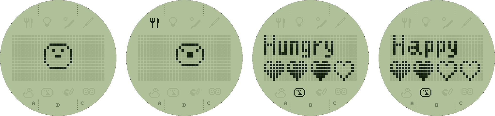
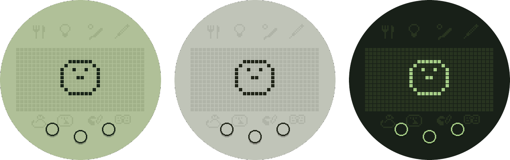
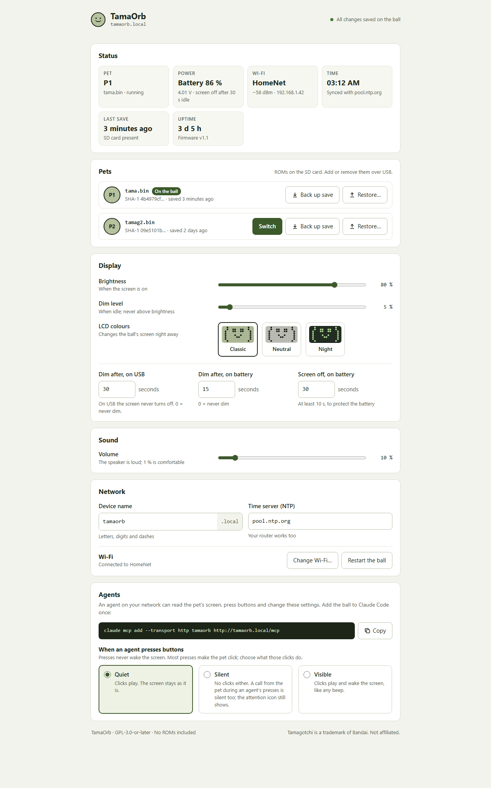
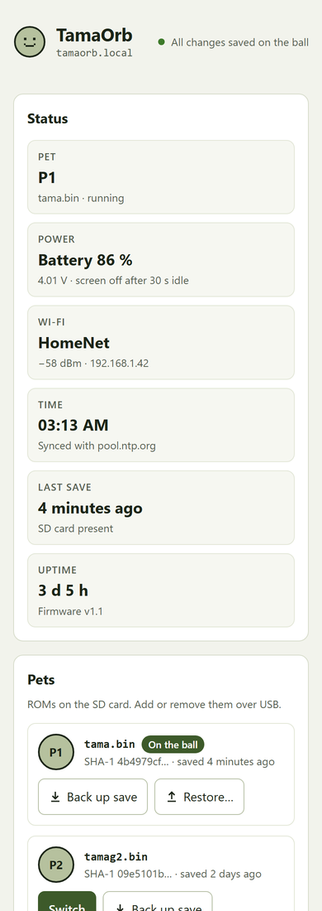

# TamaOrb

Authentic first-generation Tamagotchi emulation for round ESP32-S3 devices. TamaOrb runs the original **P1** and **P2** ROMs on [tamalib](https://github.com/jcrona/tamalib), around the clock, on the SpotPear 1.28" AI Voice Robot Ball (legs, touch and battery). A web panel on the ball handles its settings, and an AI agent can look after the pet through an MCP server that also runs on the ball.

<!-- PHOTO: the ball on a desk, screen on, pet visible (hero image, about 1200 px wide). Save as docs/images/ball.jpg and uncomment:

-->



**No ROMs are included.** Use your own dumps.

## What it does

- **Runs the real ROM in real time, all the time.** On USB power the screen stays on. On battery it turns off after 30 s, but the pet keeps living.
- **Saves crash-safely:** 3 s after you press a button, and every 5 minutes. The power button can cut power at any moment without losing the pet.
- **Catches up after power-offs.** On boot it gets the time over Wi-Fi (NTP) and replays the missed time at about 30x speed, with a progress screen. Without Wi-Fi it resumes where it was saved.
- **Each ROM keeps its own pet.** A pet on the shelf keeps aging and is caught up when you switch back.
- **Handles low battery:** it saves, shows a warning, and deep-sleeps until USB is back.
- **Has a web panel** for status, every setting, Wi-Fi, switching pets, and backing up and restoring saves.
- **Lets an AI agent care for the pet.** The ball serves MCP: the agent reads the screen, presses the buttons and follows a how-to-play guide.



## Hardware

The [SpotPear 1.28" ball](docs/hardware/spotpear-ball-128.md): ESP32-S3 with 16 MB flash and 8 MB PSRAM, a 240x240 round GC9A01 LCD, CST816D touch, an ES8311 speaker codec, a battery and a microSD slot. All hardware-specific code is in `components/board/spotpear_ball_128`, so porting to another round ESP32-S3 board means replacing that one component.

<!-- PHOTO: the ball from the side or the back, showing the USB port, the power button and the SD slot. Save as docs/images/ball-ports.jpg. -->

## Supported ROMs

| Model | Size | SHA-1 |
|---|---|---|
| P1 | 12,288 bytes | `4b4979cf92dc9d2fb6d7295a38f209f3da144f72` |
| P2 | 12,288 bytes | `09e5101b37636a314fc599d5d69b4846721b3c88` |

These are the MAME `tama` / `tamag2` sets; MAME zips work directly with the tool below.

## Controls

| Action | How |
|---|---|
| A / B / C | Touch the left / middle / right third of the screen |
| A + C | Touch A and slide to C (the touch chip can't tell two side-by-side fingers apart) |
| Wake the screen | Tap anywhere. The first tap only wakes it, it never presses a button |
| Screen on/off | Short press BOOT |
| Switch pet / ROM | Hold BOOT for 2 s: A up, C down, B pick, BOOT cancel |

## Build and flash

Needs ESP-IDF **v6.1.1**.

```bash
git submodule update --init
. ~/esp/esp-idf-v6.1.1/export.sh
idf.py set-target esp32s3 build
idf.py -p /dev/ttyACM0 flash
```

`TAMAORB_VOLUME` (0–100, in `idf.py menuconfig` → *TamaOrb board*) is only the default volume. Change it live from the web panel or with `tamaorb-rom.py set volume=…`.

## ROMs and Wi-Fi over USB

`tools/tamaorb-rom.py` needs Python 3 and `pip install -r tools/requirements.txt`. It talks to the ball over the flashing cable:

```bash
tools/tamaorb-rom.py push roms/tama.zip roms/tamag2.zip   # .bin dumps or MAME zips; only P1/P2 are sent
tools/tamaorb-rom.py list
tools/tamaorb-rom.py remove tamag2.bin
tools/tamaorb-rom.py wifi "My Network"                    # asks for the password; the ball reboots
tools/tamaorb-rom.py status
tools/tamaorb-rom.py get                                  # all settings as key=value
tools/tamaorb-rom.py set brightness=30 palette=night      # all or nothing; applied live, kept across power cuts
```

ROMs go to `/tamaorb/roms/` on the microSD card. Without a card, a pushed ROM becomes the active one directly. The active ROM is also kept in internal flash, so the pet survives a missing or failed card.

## Web panel

Once the ball is on Wi-Fi it serves a settings and status page at **`http://tamaorb.local/`** (the name is the `name` setting). Changes apply as you make them and are kept across power cuts.

<p align="center">
  
  
</p>

The same operations, plus reading the screen (`GET /api/look`) and pressing buttons (`POST /api/press`), are a JSON API under `/api/`.

**If `tamaorb.local` doesn't resolve,** use the ball's IP address instead (`http://<ip>/`). Some routers stop forwarding mDNS names about 2 minutes after the ball boots, typically when the PC and the ball are on different subnets. To find the IP, look in your router's DHCP client list, read the boot log over USB (`idf.py -p /dev/ttyACM0 monitor`, the line `esp_netif_handlers: sta ip: …`), run `tools/tamaorb-rom.py status` over USB (`ip=…`), or open the panel and read the Wi-Fi tile. Give the ball a DHCP reservation so the address doesn't change.

Without Wi-Fi, the same settings work over the cable with `tamaorb-rom.py get` and `set`.

## Agents

AI agents connect through the MCP server on the ball itself:

```bash
claude mcp add --transport http tamaorb http://tamaorb.local/mcp      # or http://<ip>/mcp
```

The agent gets `look` and `press` (the screen and the buttons), status, settings and pets, and a how-to-play guide per model (`main/guide_p1.md`, `main/guide_p2.md`). By default, beeps caused by agent presses play at normal volume but don't wake or undim the screen; `agent_feedback=silent` also mutes them and `visible` lets them wake the screen.

**The panel, API and MCP server are open to anyone on your LAN.** There is no login. Requests from other web sites are refused (Origin check), but anything on the network can read the status and press the buttons. Keep the ball on a network you trust. Decision record: `docs/adr/0005-web-panel-on-device.md`.

## Tests

```bash
test/host/run.sh                         # portable core on Linux (ROM tests use roms/*.zip if present)
pip install -r tools/requirements.txt && pytest tools
```

The parsers that take input from the network or the cable are fuzzed under ASan and UBSan:

```bash
cmake -S test/host -B build-fuzz -DTAMAORB_FUZZ=ON && cmake --build build-fuzz --target fuzz_parsers
build-fuzz/fuzz_parsers 1000000          # replay a find with: fuzz_parsers --replay fuzz-crash.bin
```

`tools/tamaorb-load.py --host tamaorb.local` load-tests the web server on a running ball. CI runs the host tests, the tool tests, a short fuzz run and the firmware build on every push.

## Project layout and docs

- `components/tama_core`, `ui`, `persist`, `hostlink`, `settings`, `remote`: portable code, host-tested.
- `components/web`: the HTTP server, the embedded panel page and mDNS.
- `components/board/spotpear_ball_128`: the only hardware-specific code. Hardware notes are in `docs/hardware/`.
- `main/`: the tasks that tie it together (emulator, UI, saves, network, the agent's press runner).
- `docs/adr/`: decisions.
- `docs/upstream/`: notes for tamalib.

## Credits and license

TamaOrb is GPL-3.0-or-later (`LICENSE`). It builds on:
- [tamalib](https://github.com/jcrona/tamalib) by Jean-Christophe Rona, GPL-2.0-or-later;
- [font8x8](https://github.com/dhepper/font8x8) by Daniel Hepper, public domain.

The icons are TamaOrb's own pixel art. The references we looked at are recorded in `docs/references/icons/`. Tamagotchi is a trademark of Bandai; this project is not affiliated with Bandai.
