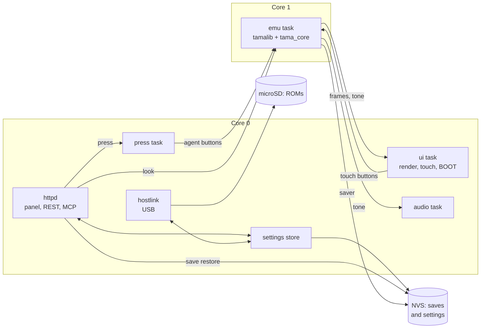

# How TamaOrb fits together

TamaOrb is one ESP-IDF app. The rule that shapes it: **core 1 belongs to the emulator.** Everything else (screen, touch, sound, saves to flash, USB, Wi-Fi, the web server) runs on core 0, and talks to the emulator only through small locked hand-offs. Most of the logic lives in portable components that build and test on a PC.

## Tasks

| Task | Core | Priority | Stack | Job |
|---|---|---|---|---|
| `emu` (`main/emu_task.c`) | 1 | 10 | 8 KB | Runs tamalib in real time, asks or catches up after time away, saves |
| `audio` (board) | 0 | 8 | 3 KB | Plays the ROM's buzzer as a square wave on the ES8311 |
| `press` (`main/press_task.c`) | 0 | 6 | 3 KB | Plays an agent's button sequence with the press tool's timing |
| `ui` (`main/ui_task.c`) | 0 | 5 | 6 KB | Draws frames and screens, reads touch and BOOT, dims and wakes the screen |
| `hostlink` (`main/hostlink_task.c`) | 0 | 4 | 4 KB | USB line protocol: ROM push, Wi-Fi, status, settings |
| `settings` (`main/settings_store.c`) | 0 | 3 | 4 KB | Writes changed settings to NVS after a 2 s pause |
| `power` (`components/power`) | 0 | 3 | 3 KB | Battery gauge, low-battery deep sleep |
| httpd (`components/web`) | 0 | default | 8 KB | Web panel, REST API and MCP server |
| Wi-Fi, lwIP, mDNS | 0 | IDF | IDF | Pinned to core 0 in `sdkconfig.defaults` |

## Data flow

- **RAM snapshot.** Inside the same lock the emulator already takes to publish a frame, it also copies the emulator's RAM. The UI decodes pet stats from that copy (`tc_pet`) for the glance, so it never waits on the emulator for more than a short copy.
- **Gestures and screens.** The `ui` task feeds touches to `ui_gesture`, which tells pet taps from edge swipes (a touch starting in an edge band never reaches the pet), and `ui_nav` switches between the pet, glance, settings pages and the ROM picker pages (list and confirm; first start runs the same list in a blocking loop before the UI task). On the pet screen only the strip under the LCD presses buttons (`ui_button_at`). Setting changes go through `settings_put`. Partial redraws use `board_display_flush_rows`.
- **Frames and buttons.** The emulator publishes a 32x16 frame plus 8 icon bits about 30 times per emulated second (`tc_get_frame`, `tc_frame_changed`). Touch and agent buttons are two masks ORed together (`tc_post_buttons`, `tc_post_remote_buttons`) and applied between instruction batches. The ROM takes about one press per 500 ms, which is why the press tool defaults to 200 ms hold + 400 ms gap.
- **Saves.** `saver_poll` runs on the emulator task: 3 s after a button release and every 5 minutes, it snapshots tamalib's state into a CRC'd record and writes the older of two NVS slots (`components/persist` has the format). A web restore freezes saving, writes the record, and restarts.
- **Pets.** A pet is a ROM plus a number 0-9 (ADR 0007). `main/pet_store.c` keeps names and the active and previous pet in a `pets` NVS namespace and finds pets from their name entries and save keys; `main/rom_switch.c` switches (save, set active, restart), creates and deletes them. Boot runs the active pet, or picks one for the cached ROM (`ps_pick_for_rom`).
- **Coming back.** With a gap of a minute or more the emulator task waits in `EMU_WAIT` (nothing runs or saves) until the ball's screen or the web panel answers: Resume (saved with the current time, then `pet_clock_auto` sets the pet's clock), Fast-forward, or Back to the previous pet (a restart, the waiting pet untouched). Shorter gaps fast-forward without asking.
- **Catch-up.** The emulator replays the missed time (NTP time minus the save's time) in fast mode, saving progress as it goes, then switches back to real time. Measured on the ball (2026-11-25, 15-minute gaps): P1 about 67x, P2 69x, Angel 37x, Mothra 75x (a week of P1 takes about 2 h 30 min). These are the defaults behind the "about N min" estimates (`tc_model_catchup_speed`) until a boot has measured its own speed. Catch-up uses tamalib's halt fast-forward (skipping the time the CPU sits halted, never past the target) for every ROM where `test_halt_ff` proved it leaves the pet in exactly the same state after 1, 6 and 26 h: all four. Only Mothra halts enough for it to matter (about 1.6x faster on the PC). Live running doesn't use it: tamalib applies it only at speed 0, and the live loop already sleeps through HALTs (light sleep). `catchup_bench` measures the speeds on the PC. Skip stops it at its next callback; the pet goes on from there, saved with the current time, and its clock is set. Other input is ignored during catch-up.
- **Factory reset.** `factory_reset_request` freezes saving, leaves a marker in RTC memory and restarts; `factory_reset_boot`, first thing in `app_main`, erases both NVS partitions before anything opens them.
- **Settings.** One table in `components/settings` validates every key. The web panel, MCP and USB all go through `settings_put`, which applies display and sound changes live and writes NVS after a pause.

## Portable components (host-tested)

| Component | What it is |
|---|---|
| `tama_core` | tamalib wrapper: frames, tones, buttons, save states, catch-up, ROM identification and selection (P1, P2, Angel, Mothra; 12 or 16 KB), per-model icon pins read from display memory (Mothra), a RAM snapshot, and `tc_pet`, which decodes pet stats per model from it |
| `ui` | Pet screen and text screens rendered into a 240x240 RGB565 framebuffer; touch zones; screen timeout; the edge-swipe gesture classifier (`ui_gesture`) and screen navigation (`ui_nav`); the glance and settings renderers (`ui_glance.c`, `ui_menu.c`); drawing QR codes from a module grid (`ui_qr.c`; `main/qr_encode.c` encodes the panel URL with the registry component `espressif/qrcode`) |
| `persist` | Save record format, save timing policy, and the pet rules (save keys, names, the boot pick) |
| `settings` | Settings table, validation, debounced writes |
| `tzdb` | IANA zone name to POSIX TZ string table, generated by `tools/gen_tzdb.py` from posix_tz_db |
| `hostlink` | USB line protocol parser |
| `remote` | Screen as text and PNG, press sequencer, save checks, JSON helpers, MCP dispatcher, REST router, Origin check |

These have no ESP-IDF headers. `test/host/run.sh` builds them with Unity on Linux, and `fuzz_parsers` fuzzes the ones that read untrusted input.

## Device-only code

- `components/board/spotpear_ball_128`: display (GC9A01 over SPI with DMA bands), touch (CST816D), audio (ES8311), battery and USB detection. The only hardware-specific component.
- `components/net`: Wi-Fi station, SNTP, and "known time" that survives resets.
- `components/web`: esp_http_server glue, mDNS, the gzipped panel page.
- `main/`: the tasks above, the ROM store (SD and NVS cache), the pet store and pet switching, the factory reset, and `remote_ops.c`, which implements `remote`'s operations table on the device.

## Tools

- `tools/tamaorb-rom.py`: ROMs, Wi-Fi, status and settings over USB.
- `tools/tamaorb-load.py`: web load test.
- `test/host/save_replay`: replays a save from the ball on the PC with a button script.
- `test/host/render_preview`: writes one screen as a PPM image.

Decisions and their reasons are in `docs/adr/`.
